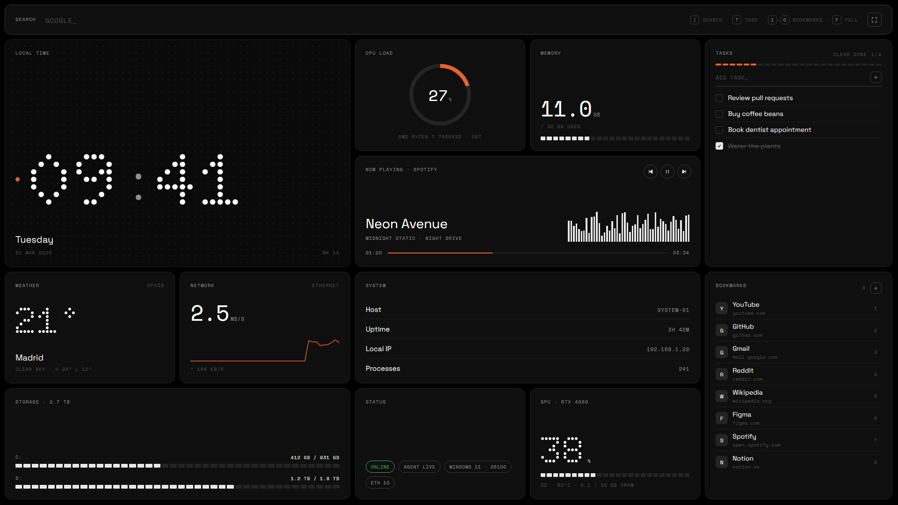
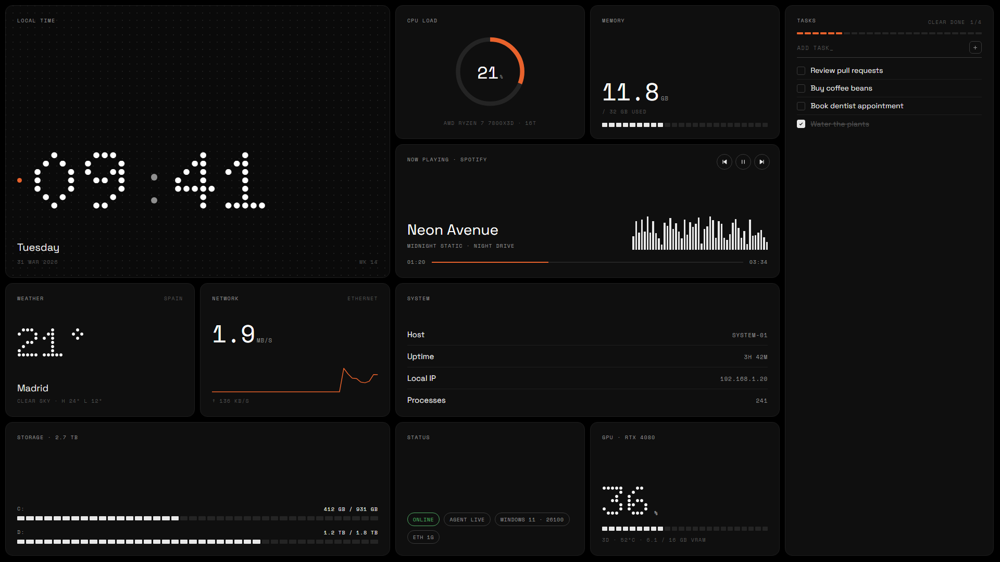

# Home / System 01

Página de inicio / nueva pestaña para Windows, a pantalla completa y en modo oscuro, con estética **dot‑matrix monocroma** (inspirada en el lenguaje visual de Nothing). Muestra datos **reales** de tu PC gracias a un pequeño agente local en Python.



**Demo en vivo:** <https://ak1ta4.github.io/homepage-dashboard/?demo> (datos ficticios, no necesita el agente).

<details>
<summary>Versión wallpaper para Wallpaper Engine</summary>



</details>

## Qué incluye

| Tarjeta | Fuente |
|---|---|
| Buscador de Google con autocompletado: sugerencias de Google, tus marcadores y búsquedas recientes; texto fantasma que se acepta con `Tab` / `→` | Google Suggest vía el agente |
| Reloj dot‑matrix, día, fecha y semana | navegador |
| CPU (anillo), memoria, discos | `psutil` |
| GPU: uso igual que el Administrador de tareas, temperatura, VRAM | contadores PDH de Windows + `nvidia-smi` |
| Red: bajada / subida en vivo con sparkline | `psutil` |
| Sistema: host, uptime, IP local, procesos | `psutil` |
| Now playing con anterior / pausa / siguiente | controles multimedia de Windows (SMTC); si Spotify no publica ahí, se lee el título de su ventana y se controla con las teclas multimedia |
| Clima (por defecto Madrid, configurable) | [Open‑Meteo](https://open-meteo.com) (sin API key) |
| Tareas: añadir, completar, editar (botón de lápiz o doble clic), limpiar hechas | `data.json` vía el agente |
| Marcadores numerados con atajos `1`–`9` y `0` (10.º), reordenables arrastrando (o con `Alt+↑/↓`) | `data.json` vía el agente |

Atajos (fuera de un campo de texto): `/` buscar · `T` nueva tarea · `1`–`9`, `0` abrir marcador · `F` pantalla completa · `Esc` salir del campo.

En el buscador: si lo que escribes coincide con el principio del nombre o dominio de un marcador (p. ej. `ani` → anilist), se autocompleta y `Enter` lo abre; `Esc` y luego `Enter` busca en Google. `↑` `↓` recorrer sugerencias · `Enter` abrir · `Ctrl+Enter` en otra pestaña · `Tab` aceptar el autocompletado · `Shift+Supr` borrar una búsqueda reciente · `Esc` cerrar.

El botón de pantalla completa usa la Fullscreen API: a diferencia de F11, el navegador no muestra la barra de direcciones al acercar el ratón arriba.

## Requisitos

- Windows 10/11
- Python 3.10+
- GPU NVIDIA opcional (para temperatura y VRAM; el % de uso funciona con cualquier GPU)

## Instalación

```powershell
git clone https://github.com/ak1ta4/homepage-dashboard.git
cd homepage-dashboard
python -m pip install --target .deps -r requirements.txt
python server.py
```

Abre <http://127.0.0.1:47800>.

Las dependencias se instalan en `.deps/` dentro del proyecto (el agente las carga de ahí). Así las encuentra también cuando Windows lo arranca al iniciar sesión: un `pip install --user` hecho desde una app empaquetada (MSIX) puede acabar en una copia privada de `%APPDATA%` que la tarea programada no ve. `install-autostart.ps1` las instala si faltan.

### Arrancar con Windows

```powershell
powershell -NoProfile -ExecutionPolicy Bypass -File .\install-autostart.ps1
```

Registra una tarea programada de Windows, `Home Agent`, que lanza `pythonw server.py` sin ventana al iniciar sesión (con 15 s de margen, sin límite de duración y con reintentos), y arranca el agente si no estaba ya en marcha. No necesita permisos de administrador y localiza `pythonw.exe` aunque Python no esté en el `PATH` (lo busca en el registro de Windows). Si existe el acceso directo de versiones anteriores en `shell:startup`, lo elimina. Lanzado con `pythonw`, el agente se ejecuta bajo un pequeño vigilante que lo relanza si se cierra, y reintenta si el puerto está ocupado o reservado por Windows; arranques y fallos quedan en `%TEMP%\home_agent.log`. Para quitarlo: `Unregister-ScheduledTask -TaskName 'Home Agent' -Confirm:$false`.

### Usarlo en el navegador

- **Página de inicio** (cualquier navegador): pon `http://127.0.0.1:47800` como página de inicio.
- **Nueva pestaña**: la carpeta `web/` es también una extensión (Manifest V3) que sustituye la nueva pestaña.
  - Chrome / Edge / Brave: `chrome://extensions` → modo desarrollador → *Cargar descomprimida* → selecciona `web/`.
  - Firefox: solo instala de forma permanente extensiones firmadas. Puedes firmarla gratis como *unlisted* en [addons.mozilla.org](https://addons.mozilla.org/developers/) (o con `web-ext sign`), o cargarla temporalmente desde `about:debugging`.

### Versión web (GitHub Pages)

`web/` se publica automáticamente en **https://ak1ta4.github.io/homepage-dashboard/** con cada push (workflow `.github/workflows/pages.yml`).

Añade `?demo` a la URL para ver el dashboard con datos ficticios (es lo que muestran las capturas). Sin el agente funcionan el reloj, el clima, el buscador con sugerencias de Google (vía JSONP), y las tareas y marcadores (guardados solo en ese navegador). Las tarjetas de sistema muestran `Agent offline`.

Si abres esa URL en el PC donde corre el agente y su origen está en `origins` de `config.json`, la versión web también muestra tus datos reales (Chrome puede pedir permiso para acceder a la red local).

### Wallpaper (Wallpaper Engine)

`wallpaper/` es un wallpaper *web* para [Wallpaper Engine](https://www.wallpaperengine.io/). Cuando el agente responde, navega al dashboard en modo `?mode=wallpaper` (sin iframe: el CEF de Wallpaper Engine se cuelga con un marco de otro origen), sin buscador ni marcadores. Las barras de *Now playing* se mueven con el **audio real** del sistema.

Las tareas se escriben en la propia tarjeta. Wallpaper Engine no pasa el teclado a los wallpapers, así que, al enfocar el campo, la página pide al agente que capture las pulsaciones con un *hook* de teclado de Windows y se las envíe (acentos, AltGr, flechas, Ctrl+V…). La captura solo arranca si el escritorio está en primer plano y termina al cambiar de ventana, con Esc, Win, Alt+Tab, al salir del campo o tras 2 min sin teclear; mientras dura, las teclas no llegan a otros programas y no se guardan. `%TEMP%\home_keys.log` registra cuándo empieza y termina la captura y cuántas teclas recibió, nunca cuáles.

Para instalarlo, copia la carpeta `wallpaper/` dentro de `wallpaper_engine\projects\myprojects\` (en tu biblioteca de Steam), o en Wallpaper Engine usa *Crear wallpaper* → selecciona `wallpaper/index.html`. Necesita el agente en marcha; si no responde, muestra `Agent offline` y lo reintenta cada 5 s.

## Configuración

- **Ubicación del clima y orígenes permitidos**: copia `config.example.json` a `config.json` y pon tu ciudad, región y coordenadas, y en `origins` la URL de tu GitHub Pages. `config.json` está en `.gitignore`, así que tu ubicación no se sube. Sin ese archivo se usa Madrid.
- **Historial del navegador**: el agente ofrece en `/api/history` los sitios y páginas que más visitas, leídos de una copia del archivo de historial de tu navegador (Chrome, Edge, Brave, Vivaldi, Opera o Firefox; el que se haya usado más recientemente). Lo usa [homepage-terminal](https://github.com/ak1ta4/homepage-terminal) para autocompletar direcciones en su buscador. En `config.json`, `"history"` puede ser la ruta a un archivo concreto (`History` o `places.sqlite`) o `false` para desactivarlo.
- **Puerto**: variable de entorno `HOME_PORT` (por defecto `47800`). Si lo cambias, actualiza también `API` en `web/app.js` para la versión extensión.

## Seguridad

- El agente solo escucha en `127.0.0.1` y rechaza peticiones con otra cabecera `Host` (protección contra DNS rebinding).
- Las escrituras (`PUT /api/data`, `POST /api/media/*`) exigen la cabecera `X-Home: 1`, lo que fuerza un preflight CORS que solo se acepta para orígenes `moz-extension://` y `chrome-extension://`. Otras webs no pueden leer tus datos ni controlar tu música.
- Los marcadores solo aceptan URLs `http(s)`.
- El historial (`/api/history`) solo se entrega a la página del propio agente y a los orígenes de `origins` (no a extensiones), y exige `X-Home`. Cualquier página publicada en ese origen (por ejemplo, todo `https://<tu-usuario>.github.io`) puede leerlo mientras el agente está en marcha.
- La captura de teclado del wallpaper (`/api/keys`) solo la puede pedir la página servida por el propio agente (mismo origen + `X-Home`) y solo mientras el escritorio está delante.
- `data.json` (tus tareas y marcadores) y `config.json` (tu ubicación) están en `.gitignore`. Las búsquedas recientes solo se guardan en el `localStorage` del navegador.
- Mientras escribes en el buscador, el texto se envía a Google para obtener sugerencias (igual que hace la barra del navegador).

## Estructura

```
server.py              agente local: estáticos + /api/stats, /api/data, /api/media/*,
                       /api/suggest, /api/history, /api/config
config.example.json    plantilla de config.json (ubicación del clima)
install-autostart.ps1  acceso directo en el Inicio de Windows
wallpaper/              wallpaper web para Wallpaper Engine (index.html + project.json)
requirements.txt
web/
  index.html  style.css  app.js
  manifest.json        para usar web/ como extensión de nueva pestaña
```

---

Proyecto personal sin afiliación con Nothing Technology Ltd. Fuentes: Doto, Space Grotesk y Space Mono (Google Fonts, OFL).
